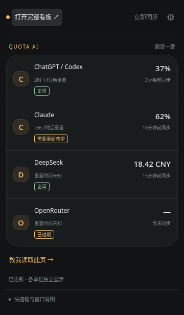

# Quota AI · AI 额度看板

一个自己部署、单所有者使用的 AI 额度总览：API 余额自动读取，个人订阅通过 AI Quota Sync 浏览器扩展自动同步，也支持手动记录。Cloudflare Worker 同时提供 React 网页和 API，D1 保存最后成功快照及加密密钥。默认深色、中文，可切换亮色与 English。

缺失值显示 `—`。百分比、订阅 credits、美元与人民币分别展示；预计重置时间过去只提示“重新读取确认”，不会把余量改成 100%。默认过期阈值：API 1 小时、自动扩展为来源读取间隔的两倍、手动 24 小时。无 Worker Cron；扩展在浏览器运行时使用 Chrome alarms。

## 本地演示

需要 Node 24、npm，版本固定在 `package-lock.json`。不需要账户、真实 API Key 或主密钥。

```sh
npm ci
npm run build
npx wrangler dev --local --var AUTH_MODE:demo
```

打开命令输出的本机地址。演示包含 11 张合成卡片及正常、低额度、重置待确认、过期、接口异常保留记录、未配置等状态；所有写操作拒绝保存，绝不调用供应商接口。不要把 demo 当成真实账户额度。

`npm run dev` 默认关闭身份入口，须通过本地变量显式设置 `AUTH_MODE`；建议按上述命令启动演示。`/healthz` 仅用于存活检查；未配置 AUTH_MODE 的其他入口返回 503。

## 部署你自己的实例（由操作者执行）

本仓库提供通用 `wrangler.jsonc`：`workers_dev: false`、`preview_urls: false`、Worker 先鉴权再提供静态资源。数据库 ID 全零是占位符，必须换成你创建的 D1 ID。以下包含远程操作，本次实现没有执行。

1. 在自己的 Cloudflare 账户创建 D1，记录返回的数据库 ID：

   ```sh
   npx wrangler d1 create ai-quota-dashboard
   ```

   可将公共模板复制为被 Git 忽略的 `wrangler.personal.jsonc`，修改其中 D1 ID，保留 `DB` 绑定、`migrations_dir: "migrations"` 与 `ASSETS` 绑定。后续命令均指向同一配置文件。不要将真实个人 ID / 路由回填公共模板。

2. 在 Cloudflare Zero Trust 创建 Access Self-hosted 应用，覆盖你自己的完整域名及所有路径，只允许所有者邮箱。设置应用对应的 DNS / Worker 自定义域名，不开启公开 workers.dev 或 preview URL。设置 Worker 变量（可写入个人配置的 `vars`）：

   ```json
   {
     "AUTH_MODE": "access",
     "CF_ACCESS_TEAM_DOMAIN": "your-team.cloudflareaccess.com",
     "CF_ACCESS_AUD": "your-access-application-audience",
     "OWNER_EMAIL": "you@example.com"
   }
   ```

   Team domain 不带协议或路径；AUD 必须取自该应用。Worker 自己校验 Access JWT 的签名、签发者、受众、有效期及邮箱，不能只依赖边缘策略。

3. 生成 32 字节随机加密主密钥，经 stdin 设置 Worker secret；不把它写入命令参数、Git、日志或聊天：

   ```sh
   openssl rand -base64 32 | npx wrangler secret put MASTER_ENCRYPTION_KEY --config wrangler.personal.jsonc
   ```

   请用密码管理器另行安全保存主密钥。已有密文不能直接换主密钥；更换后须重新录入各供应商密钥。`secret put` 会创建/部署 Worker 版本，先确认个人配置目标；下面的完整部署仍需执行。

4. 应用迁移并构建发布：

   ```sh
   npx wrangler d1 migrations apply ai-quota-dashboard --remote --config wrangler.personal.jsonc
   npm run typecheck
   npm test
   npm run build
   npx wrangler deploy --config wrangler.personal.jsonc
   ```

   自定义域名可在 Cloudflare Dashboard 绑定，或在个人配置中添加自己的路由。确认 Access 保护整个域名后访问站点。不要在真实数据实例启用 demo。

本地访问模式测试可用 `npx wrangler dev --local --var AUTH_MODE:access --var CF_ACCESS_TEAM_DOMAIN:your-team.cloudflareaccess.com --var CF_ACCESS_AUD:synthetic-aud --var OWNER_EMAIL:owner@example.invalid`；无 JWT 时返回 401。D1 本地迁移：`npx wrangler d1 migrations apply DB --local`。真实开发密钥只能放被忽略的 `.dev.vars`；不要分享该文件。

## 添加与更新

“添加服务商”选择平台和区域 → 在密码输入框填写 API Key → “测试并预览”（不保存）→ “加密保存”（输入清空）。卡片刷新读取官方余额；管理密钥可替换或清除。服务端每张卡冷却至少 60 秒，429 的 Retry-After 延长冷却；测试预览也按服务商限流。刷新失败保留上次成功快照。

订阅选择对应平台添加，再点“更新数值”。空白表示未知；可分别录入 5 小时 / 周百分比、credits、余额或资源数量。每个指标的重置输入支持 `3d 4h`、`2h 15m`、带时区 ISO 时间，或本地日期选择器；相对时间在保存时转换为绝对时间。

## 自动连接浏览器扩展

1. 从 GitHub Release 附件（如已发布）或 Actions 的 `ai-quota-sync-extension` artifact 下载 zip 并解压；或使用本地 `browser-extension/`。`npm run build:extension` 输出 `dist/ai-quota-sync-extension.zip`。
2. `chrome://extensions` → 开发者模式 → 加载已解压的扩展程序 → 选择目录并固定图标。
3. 看板「连接浏览器扩展」→ 创建设备配对码 → 扩展「配对与设置」粘贴连接。码仅显示一次，请勿分享；可在看板列出 / 撤销设备。
4. 添加订阅卡片，打开其官方额度页登录，点扩展「教我读取」后点击数值；再次打开弹窗确认预览并命名。多个指标可重复教学。配置和教学保存在看板，扩展重装后可恢复。看板设置与扩展设置都能编辑来源 URL、解析方式、间隔（全局默认 60 分钟，范围 15–10080；每个来源可选择继承默认或单独覆盖）和启用状态。

**浏览器必须运行；每站登录一次且会话仍有效即可。额度页面无需常开，扩展会自行打开后台标签页并在读取后关闭；已打开的同 URL 标签页会复用且不导航、不关闭。网站登出后重新登录一次。浏览器关闭期间不读取；页面改版可能需要重新教学，看板会明确提醒。** 启用或教学时只申请该网站权限；仅读取指定显示值，无 Cookie / Session、页面存储或整页正文读取。

操作者须应用 D1 **0002_sync.sql**，并在 Cloudflare Access 添加 **仅 `/api/ext/` 子路径** 的 Bypass（例如 `your-domain/api/ext/*` 应用），其余 HTML、静态资源、`/api/*` 保持 Access 保护。Worker 仍对扩展路径检查独立设备 Bearer；设备令牌不能访问普通 API，Access JWT 不能替代设备令牌。不要放宽成整个 `/api/*`。

扩展默认显示「灵动岛」摘要：本机缓存立即呈现，再从看板更新。每个服务商单独显示余量与单位、实时重置倒计时、状态和上次成功同步时间；点行打开官方用量页。顶部可打开完整看板、立即同步或进入 ⚙ 设置；在匹配来源域名的页面可进入「教我读取此页」，设置页也保留教学入口。重置时间到达仅提示重新确认，失败保留上次成功值。

工具栏点击或 **Alt+Q** 打开摘要；**Ctrl+Shift+9** 打开独立小窗口（重复调用复用窗口）。快捷键可在 `chrome://extensions/shortcuts` 修改；全局快捷键仅在 **Chrome 运行时** 有效，Chrome 可以未聚焦。小窗口**不置顶**。托盘常驻程序留到 [Phase 2 · Issue #1](https://github.com/alanxiaofeifei/ai-quota-dashboard/issues/1)。




完整安装、教学、告警、隐私与截图见 [扩展指南](docs/extension.md)。旧 ChatGPT 摘要 JSON 粘贴入口仍兼容。

OpenRouter 合并为一张卡片，分别保存可选的 Management Key 与普通 Key；账户余额只来自 Management Key 的 `/credits`，显示「已充值 / 已使用」。普通 Key 只显示此 Key 的消费上限 / 已用 / 剩余上限，不能代表账户余额。仅普通 Key 时主数值显示「账户余额不可用」，附创建 Management Key 链接。旧两类记录由迁移 0002 合并，原密钥保留，旧快照清除后重新读取。

## 平台覆盖

| 自动官方 API | 手动 / 扩展摘要 |
| --- | --- |
| DeepSeek；OpenRouter 账户余额（Management Key）及此 Key 消费上限（普通 Key）；Moonshot cn/ai | SiliconFlow cn/com（官方旧接口已停用，手动）；ChatGPT/Codex、Claude、Gemini/Google AI Pro、Grok、GLM/Coding Plan、Doubao/Volcengine、Qwen/Bailian、自定义 |

个人订阅没有本项目可采用的公开余额 API，因此主动记录；云平台 AK/SK 签名和组织管理员接口推迟到 Phase 2。GLM 不调用未公开 monitor 端点。SiliconFlow 官方公告已于 2026-08-14 停用 `/user/info`，因此遵照最新官方文档改为手动，不发送 API 密钥。完整接口、字段和来源见 [平台矩阵](docs/providers.md)。密码登录、组织账单与 Worker Cron 不属于当前版本；浏览器扩展的自动读取已实现。

## 验证与目录

```sh
npm ci
npm run typecheck
npm test
npm run build
npm run test:extension
npm run build:extension
npm run test:manifest
node scripts/source-manifest.mjs --worktree > /tmp/quota-source.json
node scripts/source-manifest.mjs --worktree --verify /tmp/quota-source.json
git diff --check
```

`worker/` 鉴权入口，`server/` API / 加密 / D1 / 适配器，`shared/` 真值契约 / 预设 / 双语，`web/` React，`migrations/` SQL，`tests/unit/` 模拟网络与真实 SQLite 测试。旧 Rust 源码及旧版前端位于 `legacy/rust-prototype/`，不参与 CI。

个人镜像同步：`node scripts/sync-personal.mjs /path/to/personal-checkout`。仅同步受管源码与项目文档，保留个人 README、`wrangler.personal.jsonc`、`docs/PERSONAL.md`、环境文件，重建并验证 `core-backup.json`。会删除目标中已不在来源的受管文件；请在独立、已备份的个人 checkout 使用。本次没有向个人仓运行同步。

默认 source-manifest 发布模式仍要求干净且已提交的功能源码；`--worktree` 明确标注未提交开发快照，用于本地验证与同步。CI 验证默认模式和镜像指纹。

架构与后续入口：[PROJECT](docs/PROJECT.md)、[STATUS](docs/STATUS.md)、[安全说明](docs/security.md)。保留原 LICENSE。

## English

A self-hosted, single-owner Cloudflare Workers + D1 quota dashboard. Run the local synthetic demo with `npm ci`, `npm run build`, then `npx wrangler dev --local --var AUTH_MODE:demo`. No secrets or provider calls are used in demo mode.

Deploy your own D1 database, replace the placeholder ID in a private config, protect the entire custom domain with Cloudflare Access, set `AUTH_MODE=access`, `CF_ACCESS_TEAM_DOMAIN`, `CF_ACCESS_AUD`, `OWNER_EMAIL`, and the base64 32-byte `MASTER_ENCRYPTION_KEY` secret. Apply migrations and deploy only after reviewing the target. Provider keys are encrypted and never echoed. Missing values remain unknown; estimated resets never imply recovered allowance. Password mode is deferred. AI Quota Sync provides automatic browser extension sync: download/unzip the Release attachment (if published) or Actions artifact, or use `browser-extension/`; open `chrome://extensions` → Developer mode → Load unpacked and pin the icon. Create a pairing code in the dashboard and paste it in extension Settings. On each official usage page, sign in, click Teach in the popup, click a value, then reopen the popup to confirm and name it. Add multiple metrics as needed. Sources and locators are saved in the dashboard; the global interval defaults to 60 minutes (15–10080), with optional per-source overrides. Existing sources retain their intervals; new sources inherit the global default.

**The browser must be running. Each site needs one login while its session stays valid. Usage pages need not stay open: the extension opens and closes background tabs itself. Re-login after session expiry; page redesigns may require re-teaching, with clear dashboard alerts.** Apply migration 0002 and configure a Cloudflare Access bypass for **only `/api/ext/` and subpaths**. Keep every other path protected. Device Bearer tokens, per-origin optional permissions and strict payload projection protect extension sync. See the [extension guide with screenshots](docs/extension.md).


The default popup is a compact cached quota summary with live reset countdowns, unit-separated values, sync age and failure badges. Click a provider to open its official usage page. **Alt+Q** opens the popup; **Ctrl+Shift+9** opens or focuses a reusable mini window. Customize shortcuts at `chrome://extensions/shortcuts`. Global shortcuts work only while Chrome is running, even unfocused; the mini window is **not always-on-top**. A tray companion is [Phase 2 (Issue #1)](https://github.com/alanxiaofeifei/ai-quota-dashboard/issues/1). Teach remains available from matching pages and extension Settings. Both dashboard sync settings and extension Settings edit the same global interval and per-source overrides. [Popup screenshot](docs/images/island-popup.png) · [Mini-window screenshot](docs/images/island-mini-window.png) (synthetic data).
