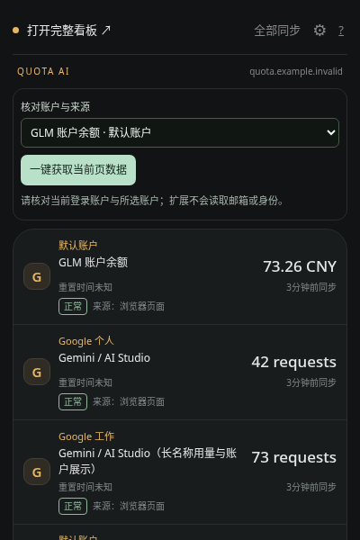

# Quota AI · AI 额度看板

一个自己部署、单所有者使用的 AI 额度总览：API 余额自动读取，个人订阅通过 AI Quota Sync 浏览器扩展自动同步，也支持手动记录。Cloudflare Worker 同时提供 React 网页和 API，D1 保存最后成功快照及加密密钥。默认深色、中文，可切换亮色与 English。

缺失值显示 `—`。百分比、订阅 credits、美元与人民币分别展示；预计重置时间过去只提示“重新读取确认”，不会把余量改成 100%。默认过期阈值：API 1 小时、自动扩展为来源读取间隔的两倍、手动 24 小时。无 Worker Cron；扩展在浏览器运行时使用 Chrome alarms。

## 本地演示

需要 Node 24、npm，版本固定在 `package-lock.json`。不需要账户、真实 API Key 或主密钥。

```sh
npm ci
npm run build
npx wrangler dev --local --var AUTH_MODE:demo
```

打开命令输出的本机地址。演示包含 11 张合成卡片及正常、低额度、重置待确认、过期、接口异常保留记录、未配置等状态；所有写操作拒绝保存，绝不调用供应商接口。不要把 demo 当成真实账户额度。

`npm run dev` 默认关闭身份入口，须通过本地变量显式设置 `AUTH_MODE`；建议按上述命令启动演示。`/healthz` 仅用于存活检查；未配置 AUTH_MODE 的其他入口返回 503。

## 部署你自己的实例（由操作者执行）

本仓库提供通用 `wrangler.jsonc`：`workers_dev: false`、`preview_urls: false`、Worker 先鉴权再提供静态资源。数据库 ID 全零是占位符，必须换成你创建的 D1 ID。以下包含远程操作，本次实现没有执行。

1. 在自己的 Cloudflare 账户创建 D1，记录返回的数据库 ID：

   ```sh
   npx wrangler d1 create ai-quota-dashboard
   ```

   可将公共模板复制为被 Git 忽略的 `wrangler.personal.jsonc`，修改其中 D1 ID，保留 `DB` 绑定、`migrations_dir: "migrations"` 与 `ASSETS` 绑定。后续命令均指向同一配置文件。不要将真实个人 ID / 路由回填公共模板。

2. 在 Cloudflare Zero Trust 创建 Access Self-hosted 应用，覆盖你自己的完整域名及所有路径，只允许所有者邮箱。设置应用对应的 DNS / Worker 自定义域名，不开启公开 workers.dev 或 preview URL。设置 Worker 变量（可写入个人配置的 `vars`）：

   ```json
   {
     "AUTH_MODE": "access",
     "CF_ACCESS_TEAM_DOMAIN": "your-team.cloudflareaccess.com",
     "CF_ACCESS_AUD": "your-access-application-audience",
     "OWNER_EMAIL": "you@example.com"
   }
   ```

   Team domain 不带协议或路径；AUD 必须取自该应用。Worker 自己校验 Access JWT 的签名、签发者、受众、有效期及邮箱，不能只依赖边缘策略。

3. 生成 32 字节随机加密主密钥，经 stdin 设置 Worker secret；不把它写入命令参数、Git、日志或聊天：

   ```sh
   openssl rand -base64 32 | npx wrangler secret put MASTER_ENCRYPTION_KEY --config wrangler.personal.jsonc
   ```

   请用密码管理器另行安全保存主密钥。已有密文不能直接换主密钥；更换后须重新录入各供应商密钥。`secret put` 会创建/部署 Worker 版本，先确认个人配置目标；下面的完整部署仍需执行。

4. 应用迁移并构建发布：

   ```sh
   npx wrangler d1 migrations apply ai-quota-dashboard --remote --config wrangler.personal.jsonc
   npm run typecheck
   npm test
   npm run build
   npx wrangler deploy --config wrangler.personal.jsonc
   ```

   自定义域名可在 Cloudflare Dashboard 绑定，或在个人配置中添加自己的路由。确认 Access 保护整个域名后访问站点。不要在真实数据实例启用 demo。

本地访问模式测试可用 `npx wrangler dev --local --var AUTH_MODE:access --var CF_ACCESS_TEAM_DOMAIN:your-team.cloudflareaccess.com --var CF_ACCESS_AUD:synthetic-aud --var OWNER_EMAIL:owner@example.invalid`；无 JWT 时返回 401。D1 本地迁移：`npx wrangler d1 migrations apply DB --local`。真实开发密钥只能放被忽略的 `.dev.vars`；不要分享该文件。

## 添加与更新

“添加服务商”选择平台和区域 → 在密码输入框填写 API Key → “测试并预览”（不保存）→ “加密保存”（输入清空）。卡片刷新读取官方余额；管理密钥可替换或清除。服务端每张卡冷却至少 60 秒，429 的 Retry-After 延长冷却；测试预览也按服务商限流。刷新失败保留上次成功快照。

订阅选择对应平台添加，再点“更新数值”。空白表示未知；可分别录入 5 小时 / 周百分比、credits、余额或资源数量。每个指标的重置输入支持 `3d 4h`、`2h 15m`、带时区 ISO 时间，或本地日期选择器；相对时间在保存时转换为绝对时间。

## 自动连接浏览器扩展 · v1.2

完整步骤见 **[中文图文教程](docs/extension-guide.zh.md)**：安装 ZIP 并固定 → 连接你自己的看板 → 授权官方网站 → 一键获取。教程包含多账户、教学后备和逐项排障，截图全部是新 UI 的合成数据。

1. `npm run build:extension` 生成 `dist/ai-quota-sync-extension.zip`；解压后在 `chrome://extensions` 开启开发者模式，加载目录并固定图标。维护者发布后也可从 Release / Actions 下载。
2. 扩展填写私人看板地址，点「打开看板创建配对码」，会打开 `<看板>/?pair=1` 并弹出配对对话框。创建设备码后回到扩展设置粘贴连接。**码相当于设备密码，只显示一次，勿分享或截图外传。**
3. 打开官方额度页并登录，点扩展「添加为来源并授权」（没有来源时）→「一键获取当前页数据」。已有卡片的预设默认启用，首次仍需授权；扩展设置提供每站「授权并启用此网站」。
4. 日常点「全部同步」，逐行查看成功或失败原因。每个账户独立建卡；例如 Google 个人 / Google 工作使用各自的 `authuser=N` 或 `/u/N/` 地址，并核对当前登录账户。教学只在预设读不到时使用：点击单个数字 → 预览数值与单位 → 确认保存。

**浏览器需开着、各家登录一次即可、额度页不必开着。** 会话过期需重新登录。扩展复用匹配页面，或自行打开临时后台页读完关闭；不读 Cookie、Session、存储或整页正文。失败保留上次成功值，重置到期仍需重新确认，单位不换算。



工具栏或 Alt+Q 打开约 400 × 600 的摘要，内部滚动；「打开独立小窗口」或 Ctrl+Shift+9 打开默认 440 × 640、可调整大小的同布局窗口。快捷键在 `chrome://extensions/shortcuts` 修改。Chrome 必须运行，小窗口不置顶；Windows 托盘伴侣目前仅有 [Issue #12 设计](docs/tray-plan.md)。

自建者需应用 D1 **0001、0002、0003**；沿用加密主密钥和现有绑定。Cloudflare Access 仅为 **`/api/ext/*`** 配置 Bypass，其余 API、HTML 和静态资源继续保护。扩展入口始终单独校验设备令牌，不能使用 Access JWT 代替。协议与兼容性见 [技术说明](docs/extension.md)。

OpenRouter 的账户 API 余额只来自 Management Key 的 `/credits`；普通 Key 预算单独显示。未取得账户余额时明确提示「账户余额需要 Management Key」，提供创建链接；也能授权读取 [官方 Credits 页](https://openrouter.ai/settings/credits) 的 Total Credits Available。可用 API 余额优先，页面余额为后备，标明来源。Gemini 主入口为 [AI Studio 用量](https://aistudio.google.com/usage)，展示 requests / tokens 用量，不把它们当成余额。

## 平台覆盖

| 自动官方 API | 手动 / 扩展摘要 |
| --- | --- |
| DeepSeek；OpenRouter 账户余额（Management Key）及此 Key 消费上限（普通 Key）；Moonshot cn/ai | SiliconFlow cn/com（官方旧接口已停用，手动）；ChatGPT/Codex、Claude、Gemini/Google AI Pro、Grok、GLM/Coding Plan、Doubao/Volcengine、Qwen/Bailian、自定义 |

个人订阅没有本项目可采用的公开余额 API，因此主动记录；云平台 AK/SK 签名和组织管理员接口推迟到 Phase 2。GLM 不调用未公开 monitor 端点。SiliconFlow 官方公告已于 2026-08-14 停用 `/user/info`，因此遵照最新官方文档改为手动，不发送 API 密钥。完整接口、字段和来源见 [平台矩阵](docs/providers.md)。密码登录、组织账单与 Worker Cron 不属于当前版本；浏览器扩展的自动读取已实现。

## 验证与目录

```sh
npm ci
npm run typecheck
npm test
npm run build
npm run test:extension
npm run build:extension
npm run test:manifest
node scripts/source-manifest.mjs --worktree > /tmp/quota-source.json
node scripts/source-manifest.mjs --worktree --verify /tmp/quota-source.json
git diff --check
```

`worker/` 鉴权入口，`server/` API / 加密 / D1 / 适配器，`shared/` 真值契约 / 预设 / 双语，`web/` React，`migrations/` SQL，`tests/unit/` 模拟网络与真实 SQLite 测试。旧 Rust 源码及旧版前端位于 `legacy/rust-prototype/`，不参与 CI。

个人镜像同步：`node scripts/sync-personal.mjs /path/to/personal-checkout`。仅同步受管源码与项目文档，保留个人 README、`wrangler.personal.jsonc`、`docs/PERSONAL.md`、环境文件，重建并验证 `core-backup.json`。会删除目标中已不在来源的受管文件；请在独立、已备份的个人 checkout 使用。本次没有向个人仓运行同步。

默认 source-manifest 发布模式仍要求干净且已提交的功能源码；`--worktree` 明确标注未提交开发快照，用于本地验证与同步。CI 验证默认模式和镜像指纹。

架构与后续入口：[PROJECT](docs/PROJECT.md)、[STATUS](docs/STATUS.md)、[安全说明](docs/security.md)。保留原 LICENSE。

## English

A self-hosted, single-owner Cloudflare Workers + D1 quota dashboard. Run the local synthetic demo with `npm ci`, `npm run build`, then `npx wrangler dev --local --var AUTH_MODE:demo`. No secrets or provider calls are used in demo mode.

Deploy your own D1 database, replace the placeholder ID in a private config, protect the entire custom domain with Cloudflare Access, set `AUTH_MODE=access`, `CF_ACCESS_TEAM_DOMAIN`, `CF_ACCESS_AUD`, `OWNER_EMAIL`, and the base64 32-byte `MASTER_ENCRYPTION_KEY` secret. Apply migrations and deploy only after reviewing the target. Provider keys are encrypted and never echoed. Missing values remain unknown; estimated resets never imply recovered allowance. Password mode is deferred. AI Quota Sync v1.2 uses built-in official-page presets: install/unzip, pair from your dashboard's `?pair=1` dialog, grant each site's permission, then Get current page or Sync all. Separate accounts use separate cards and labels; Google URLs retain `authuser=N` or `/u/N/`. Teaching is a fallback with a value/unit preview. Read the [illustrated Chinese guide](docs/extension-guide.zh.md) and [protocol notes](docs/extension.md). Browser pages and screenshot data are synthetic in automated checks; live logged-in verification remains the owner's step. Apply migrations 0001–0003 before upgrading.
