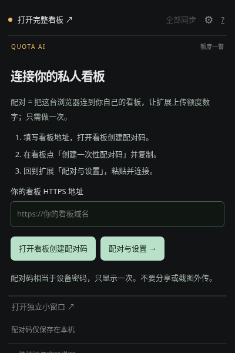
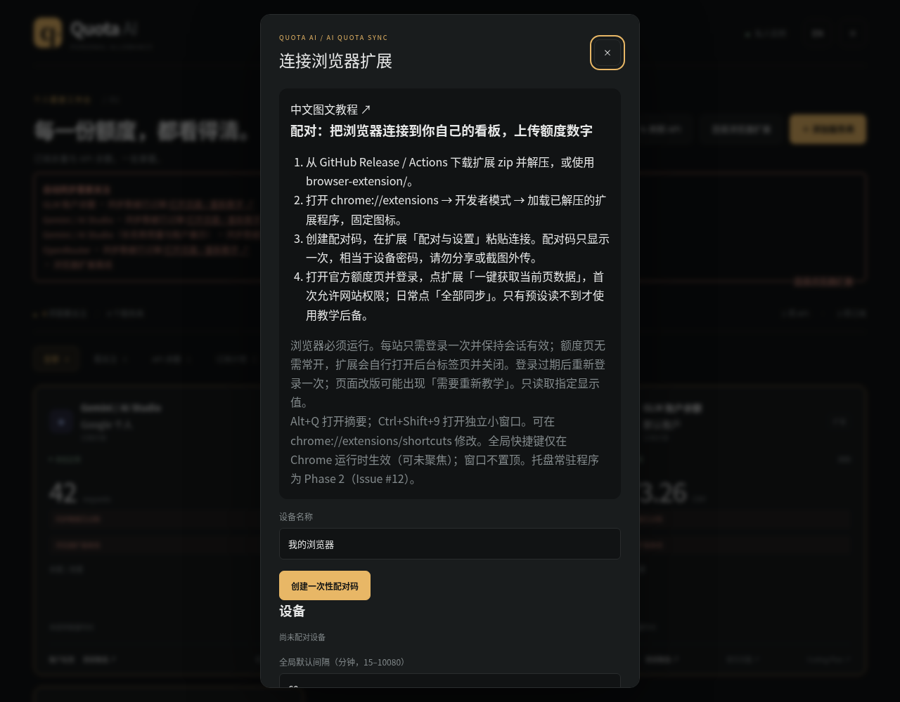
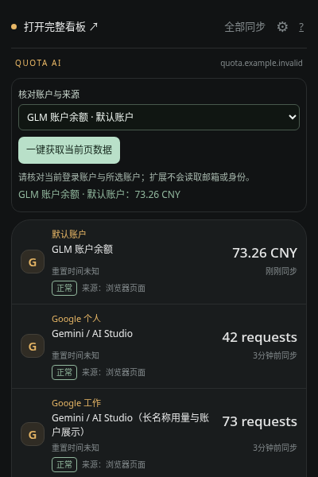
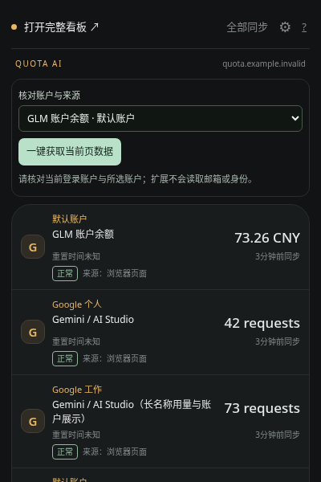
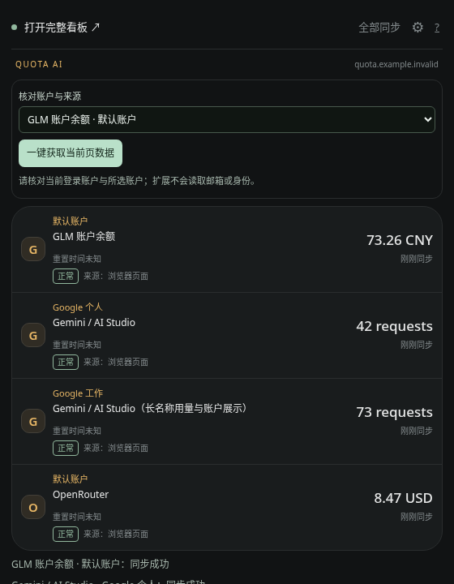
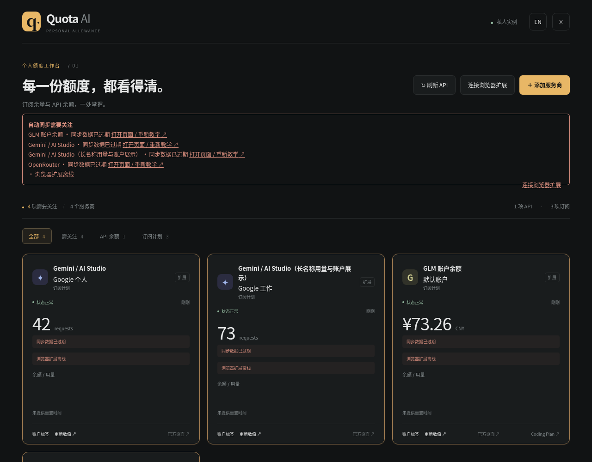
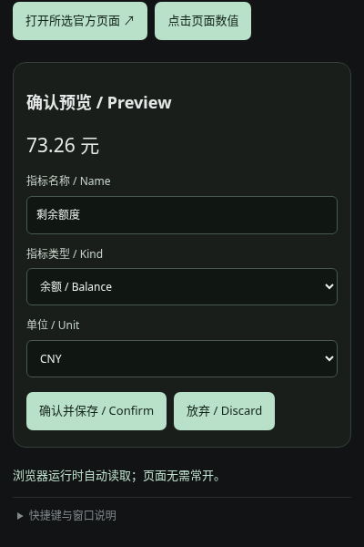

# AI Quota Sync 1.2 中文图文教程

扩展把你在官方网站看到的额度数字上传到你自己的看板。先配对，再授权官方网站，日常使用「一键获取当前页数据」或「全部同步」。以下截图来自加载了真实 MV3 扩展的新 Chrome 配置，数值和账户标签全部为合成示例；页面读数、权限和看板响应使用模拟适配器，不代表真实账号已验收。

## 1. 安装 ZIP 并固定图标

1. 下载项目 Release 中的 `ai-quota-sync-extension.zip`（1.2.0 需由维护者发布后才可下载），或 Actions 的同名构建附件。开发者可在本仓执行 `npm ci`、`npm run build:extension`，ZIP 位于 `dist/`。
2. 解压 ZIP，保留整个目录。升级时替换原目录内容，再在扩展管理页点击重新加载；不要直接选择 ZIP。
3. 在 Chrome 地址栏打开 `chrome://extensions`，开启右上角「开发者模式」。
4. 点「加载已解压的扩展程序」，选择包含 `manifest.json` 的目录。
5. 点浏览器右上角拼图图标，把 AI Quota Sync 固定到工具栏。

## 2. 配对：连接到你自己的看板

配对只需做一次：它允许这台浏览器向你的私人看板上传数字。**配对码相当于设备密码，只显示一次，不要发给别人或截图外传。** 设备令牌只留在本机；丢失浏览器设备时，可在看板撤销它。

1. 点扩展图标，填写你的看板 HTTPS 根地址，例如 `https://你的看板域名`，点「打开看板创建配对码」。按钮打开 `https://你的看板域名/?pair=1`；完成看板登录后，会自动打开配对对话框。
2. 在看板填写设备名称，点「创建一次性配对码」，复制配对码。关闭对话框后无法再查看原码；需要时重新创建。
3. 回到扩展，点「配对与设置」，粘贴到配对码框，点「连接」。成功后显示已连接的看板主机名；可从这里移除本机配对后重新连接。

如果看板拒绝访问，应先正常登录你的 Cloudflare Access 账户。自建者必须先应用迁移 0001、0002、0003，并仅为 `/api/ext/*` 配置 Access Bypass；其余路径保持保护。不要为方便配对放开整个站点。

## 3. 添加服务商并授权

方式一：在看板点「添加服务商」，选择平台，填写账户标签，例如「Google 个人」。扩展预设默认启用；打开扩展设置，点对应来源的「授权并启用此网站」，允许该官方网站。

方式二：直接打开下面表中的官方额度页并登录，再点扩展。若尚无来源，扩展会识别平台，显示「添加为来源并授权」。填写账户标签并点击，随后点「一键获取当前页数据」。无需先录入 API 密钥，也无需先教学。

| 服务商 | 打开的官方页面 | 如何读取 |
| --- | --- | --- |
| OpenRouter | [Credits](https://openrouter.ai/settings/credits) | 页面预设读取 Total Credits Available（USD）；官方 API 账户余额需 [Management Key](https://openrouter.ai/settings/management-keys)，普通 Key 仅显示此 Key 预算。可用 API 余额优先，页面余额作为后备，来源会标明。 |
| GLM | [财务总览](https://bigmodel.cn/finance-center/finance/overview) | 读取「当前余额」（CNY）。 |
| GLM Coding Plan | [用量统计](https://www.bigmodel.cn/coding-plan/personal/usage) | 读取明确显示的剩余 / 已用百分比，存在相对重置文本时记录预计重置。 |
| ChatGPT / Codex | [ChatGPT 用量](https://chatgpt.com/settings/usage?tab=overview) / [Codex 用量](https://chatgpt.com/codex/settings/usage) | 5 小时、周额度及独立 credits；多个指标分别显示。 |
| Claude | [用量](https://claude.ai/settings/usage) | 当前会话 / 周额度，需要页面明确显示百分比及剩余或已用含义。 |
| Gemini / Google AI | [AI Studio 用量](https://aistudio.google.com/usage) | 读取页面显示的请求 / token 用量，**这些不是余额或剩余额度**。Gemini 聊天应用页无本项目可读余额。 |
| DeepSeek | [用量](https://platform.deepseek.com/usage) | 页面可用余额（CNY）；API 卡可用任一本账户 API Key。 |
| Kimi / Moonshot | [国内账户](https://platform.kimi.com/console/account) / [国际账户](https://platform.kimi.ai/console/account) | 国内 CNY / 国际 USD；API Key 区域不能互换。 |
| Grok / xAI | [xAI 控制台](https://console.x.ai/) | 仅识别明确的 Credit balance（USD）；Grok 聊天页不会凭空显示额度。 |
| 豆包 / 火山引擎 | [资金总览](https://console.volcengine.com/finance/fund/overview) | 账户余额（CNY）。 |
| Qwen / 百炼 | [阿里云费用首页](https://billing-cost.console.aliyun.com/home) / [百炼](https://bailian.console.aliyun.com/) | 费用首页的 CNY 余额；百炼明确显示的 token / 请求用量。 |
| SiliconFlow | [国内余额](https://cloud.siliconflow.cn/account/balance) / [国际余额](https://cloud.siliconflow.com/account/balance) | 页面余额，国内 CNY / 国际 USD；不调用已停用余额 API。 |

各家页面布局不同，预设只在唯一、可见的标签附近读取小块数值。页面没有这些数字时会提示原因，可打开正确页面或使用教学后备。预设通过合成夹具验证，仍需你在真实已登录页面确认。

## 4. 一键获取当前页数据

1. 在官方额度页确认已登录正确账户、数值已加载。
2. 点扩展，核对「账户与来源」。首次点击读取时允许该网站权限。
3. 点「一键获取当前页数据」。窗口内会显示平台、账户、数值与单位；随后看板与摘要更新。
4. 非官方额度页会提示先打开正确页面；没有匹配来源时先「添加为来源并授权」。

失败时不会写成 0，也不会抹掉上次成功数值。旧数值可能仍显示，务必同时查看原因和同步时间。

## 5. 全部同步和日常使用

点「全部同步」会刷新配置，逐个读取所有已启用来源；下方显示每个来源 / 账户的等待、读取、成功或失败原因。首次使用前，请在设置里逐站授权。没有启用的来源不会参与同步。

**浏览器需开着、各家登录一次即可、额度页不必开着。** 这里的「一次」以登录会话仍有效为前提；会话过期后需要重新登录。扩展复用已打开的匹配页面，或在后台打开临时页面，读完关闭自己创建的页面；不会导航或关闭你原本打开的页面。电脑休眠、浏览器关闭、网站挑战或限流会延迟读取。

全局间隔默认 60 分钟，范围 15–10080；各来源可继承或单独覆盖。预计重置时间到了，只会显示「重置待确认」，不会把剩余数值变为 100%。

工具栏弹窗约 400 × 600，列表在内部滚动。Chrome 工具栏弹窗无法拖拽调大小；点「打开独立小窗口」可以获得默认 440 × 640、能调整大小的窗口。

## 6. 多账户：Google 个人 / Google 工作

每个账户建立独立卡片。可在看板「账户标签」修改名称，也可在扩展 / 看板的来源设置编辑账户标签；同一卡片的来源共享标签，成功快照保留当时标签。不会自动读取邮箱。

1. 在浏览器切换到第一个 Google 账户，打开 `https://aistudio.google.com/usage?authuser=0`，从扩展添加为来源，标签填「Google 个人」。
2. 切换到第二个账户，打开 `https://aistudio.google.com/usage?authuser=1` 或 `https://aistudio.google.com/u/1/usage`，添加为来源，标签填「Google 工作」。
3. 核对网页当前账户和标签后分别获取。摘要和看板按服务商 → 账户排列，官方页面链接保留对应账户 URL。

`authuser` / `/u/N/` 是该浏览器的账户序号，不是永久身份凭据；增删 Google 登录账户后，序号可能变化，须手工核对并更新来源 URL。**扩展不会读取身份信息，因此无法证明未带账户标识的网站上当前登录的是谁。** 多张卡片使用同一 URL 时，必须从下拉框明确选择来源并核对页面账户；后台读取共享浏览器会话；不同卡片的已启用来源若匹配同一 URL，全部同步会拒绝读取并提示账户不匹配。其他平台如需同时登录不同账号，请使用独立 Chrome 配置文件并分别配对，或禁用自动读取后逐账户手动获取。

## 7. 教学仅作为预设失败后的后备

1. 打开正确的官方额度页，确认账户。在扩展点「预设读不到？教我读取此页」。
2. 选择来源，点「点击页面数值」。弹窗会关闭，页顶出现引导；点击单个可见数值，例如 `73.26 元`。点错会在页顶提示，可以重试，Esc 取消。
3. 再点扩展图标，核对预览。默认指标名为「剩余额度」；货币会建议 CNY / USD。百分比必须核对页面写的是剩余还是已用；选择「已用百分比」才会换算为剩余百分比。不能把金额当作 percent。
4. 点「确认并保存」，会显示保存的数值与单位并立即同步此来源。教学保存在看板，重装后重新配对即可恢复。

定位优先使用可见标签、aria 或稳定属性。不会新建 React `_r_` id 或深层 `nth-of-type` 路径。旧定位器仍保留；旧路径若只有动态 ID 且没有可用标签，会提示页面改版，请重新教学。跨域 iframe、封闭 Shadow DOM、没有稳定标签的数值及多个歧义值可能无法教学；不要点击整块账单或聊天内容。

## 8. 排障

| 提示 / 现象 | 操作 |
| --- | --- |
| `—` / 尚未同步 | 先确认添加了来源、已启用并授权，打开正确官方页，点获取。空白不表示 0。 |
| 账户余额需要 Management Key | OpenRouter 普通 Key 只能读 Key 预算。创建并保存 Management Key，或授权并读取官方 Credits 页。 |
| 需授权 | 设置里点该来源「授权并启用此网站」；或当前页点获取并允许权限。 |
| 需登录 | 点该行打开官方页，重新登录该账户，再获取。 |
| 此页没有可识别的额度数字 | 等页面加载，核对用量页地址。Gemini 应用不是余额页；打开 AI Studio usage。页面确无数字时保持未知。 |
| 页面改版 / 需重新教学 | 核对页面后使用教学后备，选择单个有稳定标签的数字。 |
| 超时 | 页面可能遇到验证码 / 安全挑战，手动打开处理，再重试。不会尝试绕过挑战。 |
| 账户地址不匹配 | 核对来源 URL 中的 authuser / /u/N/，以及当前登录账户；不要把两账户来源绑到同一卡片。 |
| 网络或上传失败 / 扩展离线 | 确认浏览器运行、看板可达，必要时重新配对；检查 Access 是否仅为 `/api/ext/*` 配置 Bypass。 |
| 未启用 | 在来源设置启用；预设外的教学来源需先保存至少一个指标。 |
| 配对失败 / 设备被撤销 | 在私人看板重新创建码并连接；不要粘贴到第三方网站。 |
| 快捷键没反应 | 打开 `chrome://extensions/shortcuts` 改键，检查系统冲突；浏览器必须运行。 |
| 弹窗内容多 | 内部向下滚动；或打开独立小窗口并调整尺寸。 |

Alt+Q 打开摘要；Ctrl+Shift+9 打开 / 复用独立窗口。全局快捷键可在 Chrome 未聚焦时使用，但 Chrome 必须运行，窗口不置顶。浏览器关闭后的 Windows 托盘、自启、全局热键和置顶属于 [Issue #12 的规划](tray-plan.md)，本版本没有实现。
