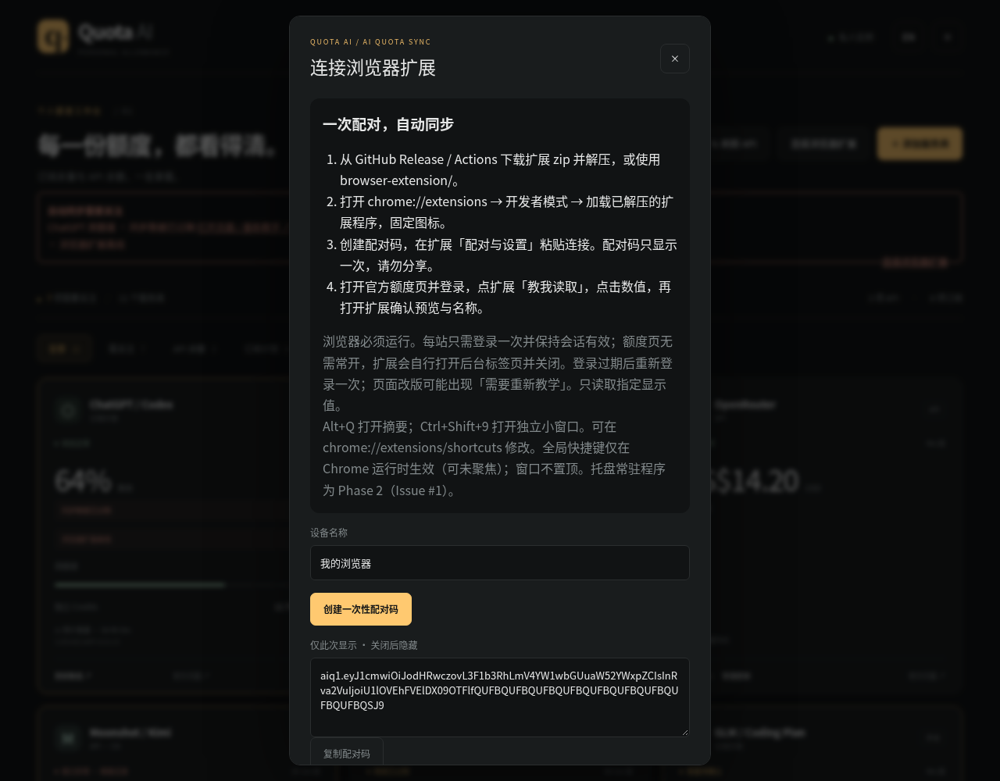
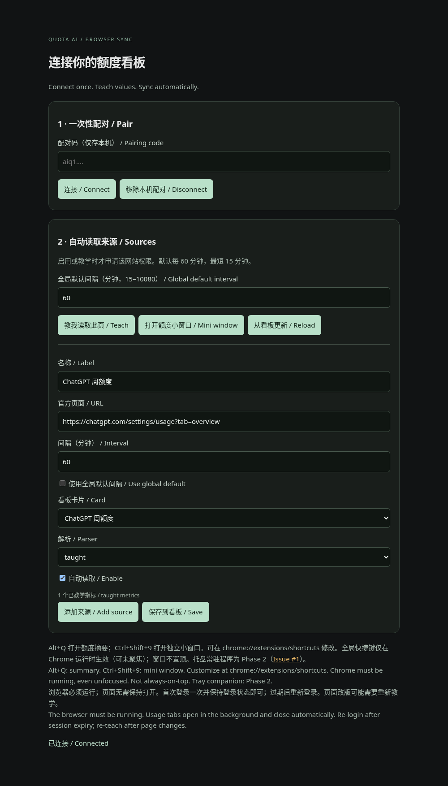
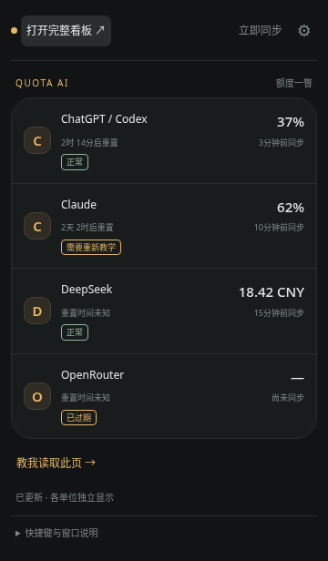
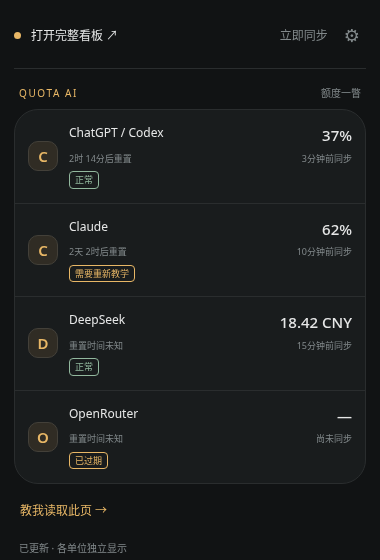
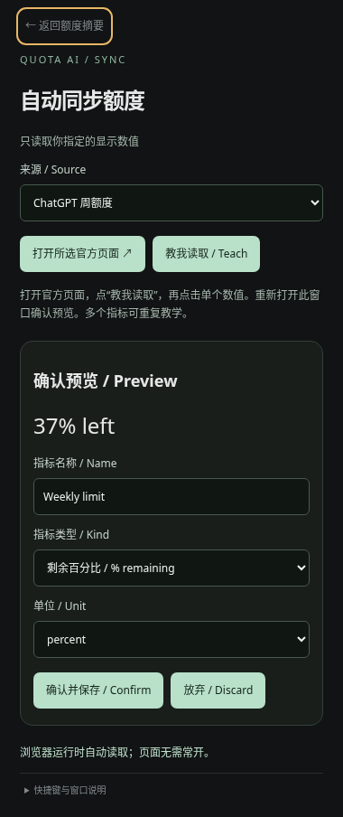

# AI Quota Sync · 浏览器自动同步

MV3 Chrome 扩展，配对一次后自动读取指定的官方额度显示值，发到你自己的看板。没有供应商密码、Cookie、Session、网页存储或网络拦截权限。普通 API Key 不用于读取订阅页。

## 安装与配对

1. 从项目 GitHub Release 的附件（如操作者已附加），或 GitHub Actions 的 `ai-quota-sync-extension` artifact 下载 zip。解压；本地开发也可直接用仓库 `browser-extension/`。`npm run build:extension` 生成 `dist/ai-quota-sync-extension.zip`；CI 上传 artifact，不自动创建 Release。
2. 打开 `chrome://extensions`，启用「开发者模式」→「加载已解压的扩展程序」→ 选择含 `manifest.json` 的目录。在工具栏固定 AI Quota Sync 图标。
3. 看板「连接浏览器扩展」→ 填写设备名称 →「创建一次性配对码」。码是一个 `aiq1.…` 字符串，仅在本次响应显示。关闭对话框后不会再次显示；遗失时撤销设备并重新创建。配对码具有设备权限，请勿截图或分享真实码。
4. 扩展图标 → ⚙「配对与设置」，粘贴码并点「连接」。浏览器只在本机 `chrome.storage.local` 保存令牌，绝不使用同步存储。首次连接需允许访问自己的看板域名。
5. 看板列出设备名称、创建记录、最近心跳；可随时撤销。撤销后立即返回 401；扩展「移除本机配对」只移除本机缓存，不替代服务端撤销。

<!-- Screenshot placeholder: pairing dialog (replaced with local synthetic demo capture). -->

<!-- Screenshot placeholder: extension options (local HTML with synthetic browser adapters). -->

## 额度摘要与小窗口

工具栏图标或建议快捷键 **Alt+Q** 打开约 360px 的深色「灵动岛」摘要。它先从本机缓存显示上次概要，再调用 `GET /api/ext/summary` 更新；长开的小窗口每分钟更新摘要，倒计时每秒更新，不主动访问供应商页面。每个服务商一行：名称首字母、主余量与独立单位、重置倒计时、正常 / 过期 / 读取失败 / 需要登录 / 需要重新教学 / 扩展离线、上次成功同步距今时间。行点击打开该服务商的官方 `usageUrl`。缺失值为 `—`，失败保留上次成功值；预计重置到时显示「重置待确认」，不会改成 100%。顶部状态点汇总各行状态；按钮可打开完整看板、立即同步启用的来源、进入设置。未配对时显示短说明和「去配对」。

建议快捷键 **Ctrl+Shift+9** 是全局命令，打开同一摘要的 **380 × 560** 独立 popup 类型窗口，已打开则聚焦复用。快捷键可在 `chrome://extensions/shortcuts` 修改，实际分配可能受操作系统或其他扩展冲突影响；全局快捷键仅在 **Chrome 运行时** 生效，Chrome 可未聚焦。它**不是始终置顶**窗口，也不是系统托盘常驻程序；托盘 companion 留在 [Phase 2 · Issue #1](https://github.com/alanxiaofeifei/ai-quota-dashboard/issues/1)。[Chrome commands 官方说明](https://developer.chrome.com/docs/extensions/reference/api/commands) 与 [windows 官方说明](https://developer.chrome.com/docs/extensions/reference/api/windows)。

教学作为次级视图保留：当前标签页与已配置来源同域时，摘要显示「教我读取此页」。也可从设置的「教我读取此页」进入教学页，选择来源、打开官方页后返回教学页发起教学；成功选值后重新打开扩展确认预览。教学视图可返回摘要。

## 教学与自动读取

先在看板添加订阅卡片。每个手动服务商卡片自动生成默认关闭的官方来源；ChatGPT 和 Codex、GLM 余额和 Coding Plan 各有来源。来源在看板设置与扩展设置均可修改：卡片、标签、HTTPS 官方页 URL、启用状态、解析方式、间隔（全局默认 60 分钟，范围 15–10080）。看板与扩展设置共用全局默认间隔，来源勾选「使用全局默认间隔」后随默认值变化；取消勾选即可单独覆盖。新来源默认继承，旧来源保留原有间隔。保存通过现有 config 协议同步，默认值持久化在 D1 meta，无需新迁移。允许新增来源；禁用来源会保留教学数据。扩展每 15 分钟获取最新配置；设置保存后也会立即获取。

打开对应的官方额度页并登录。摘要进入「教我读取此页」后选择来源 →「教我读取」→ 点击一个只含数值的小元素；再次打开扩展，确认显示预览，填写指标名称、类型和单位 →「确认并保存」。可重复添加最多 8 个指标，使用相同名称可重新教学该指标。剩余百分比与已用百分比分开选择；后者明确转换为 `100 − 已用`。金额、credits、tokens、requests 不换算。重置指标支持显示的 `3d 4h`、`2h 15m` 或带时区 ISO 时间，按本次观测时刻转换为绝对时间；不支持含糊的自然语言日期。数值只接受明确的单一数字与单位；有歧义的逗号分隔格式会报布局变化，不猜测小数或千位。

定位器由附近前置标题 / label、小元素 CSS 路径、固定数值表达式、单位、类型构成；配置保存在看板并缓存在扩展，重装后配对即可恢复。更改来源 URL 会要求重新授权 / 教学。启用或教学时由用户点击触发 `chrome.permissions.request`，仅申请该来源的 origin；manifest 无默认全站权限，无 `<all_urls>`。在看板远程启用新域名时，必须在扩展设置中切换启用并批准该站权限。

ChatGPT / Codex 预设仅查找语义标题旁的小额度区域，解析 Weekly limit、5-hour limit、Resets in、credits remaining。找不到明确显示值会失败，绝不读整页正文或用 0 填补。页面组件和语言可能变化；预设无法识别时改用教学。旧手动选区解析器保留为兼容纯解析模块和回归测试，不再作为扩展主流程。

<!-- Screenshot placeholder: popup/teach preview (local synthetic element). -->

**浏览器必须运行。每个网站只需登录一次，并保持会话有效（Cookie 由网站和浏览器正常保存，扩展不读取 Cookie）。额度页面无需保持打开：扩展会自行打开不激活的后台标签页，条件允许时使用最小化且不聚焦的窗口，读取完关闭自己打开的标签页。已有同 URL 标签页会复用且不导航、不关闭。** 浏览器关闭、休眠或定时器被 Chrome 延迟时不会读取，不保证精确分钟调度。网站登出后再登录一次即可。页面改版会导致「需要重新教学」，重新打开页面教学对应指标。

看板横幅和卡片提示：同步失败（网络 / 权限）、登录过期（重新登录链接）、需要重新教学、超过 `2 × 来源间隔` 未成功读取、超过 `2 × 最短启用间隔` 无设备心跳（扩展离线）。扩展在新失败状态显示通知，同一来源相同状态不重复通知；通知按钮打开官方页，之后点图标重新教学。请求失败的投影状态会缓存在本机，下次连接重试；没有上传成功时看板仍以旧观测时刻计算过期。

## 自托管配置与协议

操作者必须在 Cloudflare Access 为 **仅 `/api/ext/` 子路径** 配置 Bypass（例如专门的 `your-domain/api/ext/*` Access 应用使用 Bypass policy），保留整个站点其余入口的 Access 保护。不要 bypass `/api/*` 或根路径。Worker 的 `/api/ext/*` 完全独立验证设备 Bearer，不使用 Access JWT；其他 API 和静态资源仍验证所有者 Access JWT。保留 `AUTH_MODE=access` 及完整 Access 配置；缺失配置时扩展入口也关闭。demo 不允许配对或设备写入。

应用 D1 **0002_sync.sql**（已有 0001 的实例也必须升级）。它建立设备 / 来源 / 状态表并合并旧 OpenRouter 行。沿用原 `DB`、`ASSETS`、`MASTER_ENCRYPTION_KEY`、`CF_ACCESS_TEAM_DOMAIN`、`CF_ACCESS_AUD`、`OWNER_EMAIL`；无需新增 Worker secret 或 Cron。设备令牌由 Worker 随机生成 32 字节，D1 仅保存 SHA-256 哈希，按哈希查找后固定长度比较；不记录令牌或上游原文。

设备接口：`POST /api/ext/hello`、`GET /api/ext/config`、`GET /api/ext/summary`、`POST /api/ext/config`、`POST /api/ext/ingest`、`POST /api/ext/heartbeat`（`/status` 同义）。设备请求不携带浏览器凭证，必须使用 `Authorization: Bearer <device token>`，禁止重定向。每设备每分钟最多 120 次，JSON 流式上限 32 KiB；CORS 仅允许合法 `chrome-extension://` origin，无 credentials，只允许 GET/POST/OPTIONS 与 Authorization/Content-Type。普通网页无跨域许可。无 Origin 的原生客户端仍需设备令牌。

Summary 使用相同设备鉴权和每分钟限流，返回 `providers` 显式投影：`id/name/usageUrl/primary {value,unit}/reset_at/last_sync_at/status`，不含凭证、设备详情或教学定位器。它只读取已保存快照，不调用供应商。Config 包含 `defaultIntervalMinutes`，来源的 `useDefaultInterval` 决定是否继承，返回 `intervalMinutes` 为当前有效间隔。

Ingest 仅接受 `sourceId`、`providerId`、`items`、`observed_at`、`status`；item 只接受 `id`、`amount`、`unit`、`resetAt`。拒绝未知字段、未启用或不匹配来源、非教学指标、未来 / 倒序观测。失败状态的 items 必须为空，保留最后成功快照。每个卡片展示最近成功来源的一组指标；需要分别保留 ChatGPT 与 Codex 时，添加两张卡片并分别绑定来源。单所有者设备都具有编辑来源和写入手动卡片额度权限；不要把配对码给不信任的设备。

目前仅顶层 DOM，不读取跨域 iframe、封闭 shadow DOM 或非显示数据。读页面加载最多 20 秒，加载后等待定位器最多 20 秒；验证码、安全挑战及不可见懒加载组件可能需要人工处理。真实供应商登录页未在自动测试中访问，测试与截图全部使用合成数据和模拟网络。

## English

Install from a GitHub Release attachment (if published) or the Actions `ai-quota-sync-extension` artifact, unzip it, or use `browser-extension/`. Open `chrome://extensions`, enable Developer mode, choose Load unpacked, and pin the icon. In the dashboard choose Connect extension, create a device code, and paste it into extension Settings. Codes are shown once; tokens stay in `chrome.storage.local`, never synced. Revoke a lost device in the dashboard.

Add a manual provider card, log into its official usage page, select its source in the popup, click Teach, and click a single displayed value. Reopen the popup, confirm the preview, name the metric, and choose its kind and unit. Repeat for multiple metrics. Presets support small ChatGPT/Codex weekly, 5-hour and credit sections; use teaching if the layout is not recognized. Sources, locators, intervals and enabled state are editable without code changes and backed up to your dashboard. Grant host permission per origin when enabling or teaching a source. Default interval is 60 minutes, minimum 15.

**The browser must be running. Each site only needs a one-time login while its session remains valid. The usage page does not need to stay open: the extension opens a background tab and closes its own tab afterward, or reuses an existing matching tab without navigating or closing it.** Log in once again after a session expires. Reads occur only while the browser runs; sleeping computers and throttled alarms can delay them. Page redesigns may break a locator: the dashboard shows “Re-teaching required”. New failures trigger deduplicated notifications with an Open page button.

Self-hosters must configure a Cloudflare Access bypass for **exactly `/api/ext/` and its subpaths**, keep Access on every other path, and apply migration 0002. Worker device-token checks still apply to bypassed routes. Device tokens cannot call the owner APIs, and Access JWTs cannot replace device tokens. No cookies, page storage, request interception or full page text are read. Only projected measurements and parser status go to the paired dashboard. Screenshots show real local rendering of synthetic fixtures, not a live account. Separate cards are recommended for sources whose independent snapshots must remain visible.

The default Dynamic Island summary paints the last overview from local cache before refreshing `GET /api/ext/summary`. Rows show primary values with explicit units, live reset countdowns, badges and successful-sync age; clicking opens the provider's official usage page. Missing values stay unknown; expired resets require confirmation. Teach is a secondary view reachable on a matching source origin and from Settings. Both settings editors share the persisted global default (60 minutes, range 15–10080) and per-source inheritance/overrides; legacy sources keep their existing intervals.

Suggested **Alt+Q** opens the toolbar popup. Global **Ctrl+Shift+9** opens or reuses the 380 × 560 mini window. Change shortcuts at `chrome://extensions/shortcuts`; OS conflicts can prevent assignment. Chrome must be running, even if unfocused. The mini window is **not always-on-top**. The tray companion is [Phase 2 / Issue #1](https://github.com/alanxiaofeifei/ai-quota-dashboard/issues/1). The summary endpoint uses the same device auth and rate limit and projects only public display fields, with no credentials or teaching locators.
